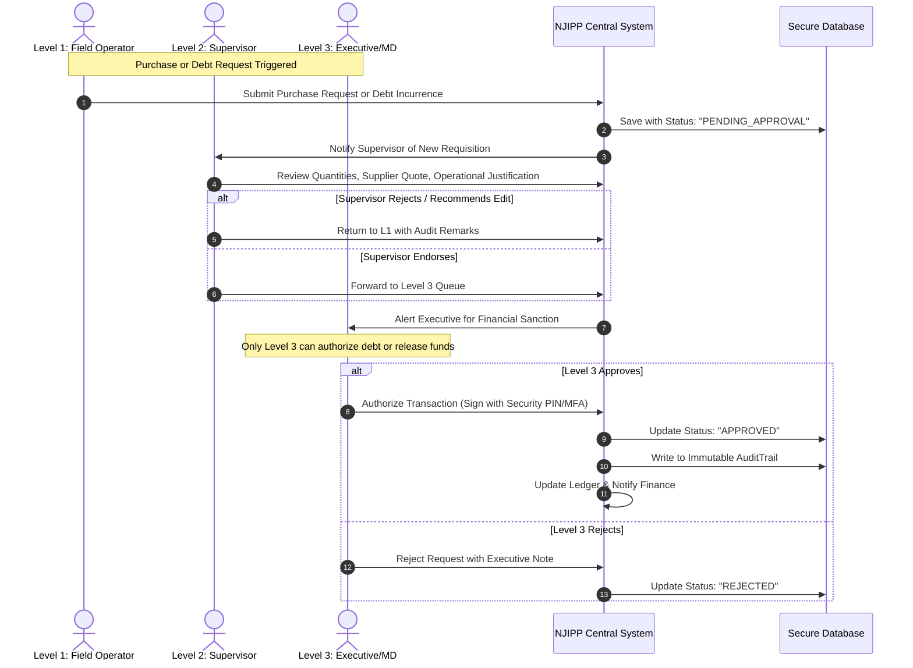
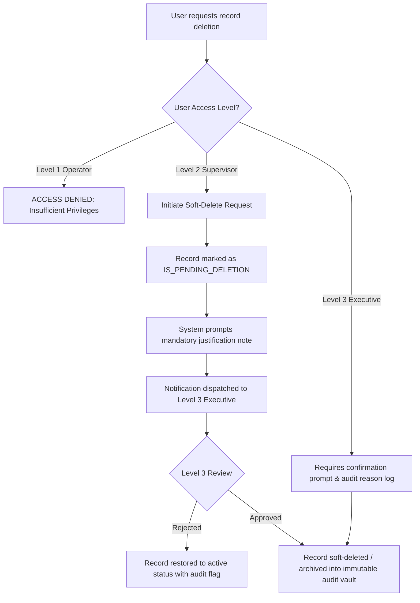
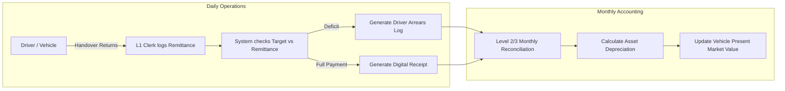

# NJIPP KONSULT LTD — Enterprise Management System (EMS)
## Integrated Farm, Transport Services & Multi-Venture ERP Blueprint
**Document Version:** 1.0.0  
**Prepared By:** Project Manager & Lead Software Systems Engineer  
**Target Organization:** NJIPP KONSULT LTD  

---

## 1. Executive Summary & Vision

**NJIPP KONSULT LTD** is scaling into a multi-sector enterprise with primary active operations across **Integrated Farming (Livestock & Agronomy)** and **Commercial Transport Services (Motorcycles, Buses, Trikes)**, backed by a strategic pipeline of future business ventures (**Viewing Centre, Cash Crops Production, Table Water Factory, and Commercial Tree Planting**).

To streamline multi-unit accountability, eliminate revenue leakage, track assets and livestock health, and enforce strict fiscal governance, NJIPP requires a unified, modern web-and-mobile-accessible **Enterprise Portal & Management Dashboard**.

This document outlines the **end-to-end architectural blueprint**, **technical stack recommendation**, **role-based access control (RBAC) governance**, **database schema specifications**, and **implementation roadmap**.

---

## 2. Business Domains & Functional Specifications

```
                     +-------------------------------------------------------+
                     |                 NJIPP KONSULT LTD                     |
                     |           CENTRAL ENTERPRISE DASHBOARD                |
                     +---------------------------+---------------------------+
                                                 |
         +---------------------------------------+---------------------------------------+
         |                                       |                                       |
+--------v----------------+             +--------v----------------+             +--------v----------------+
|  INTEGRATED FARM ERP    |             |  TRANSPORT & FLEET      |             |  FUTURE VENTURES ENGINE |
| - Poultry Section       |             | - Motorcycles (Bikes)   |             | - Viewing Centre        |
| - Sheep Section         |             | - Commercial Buses      |             | - Cash Crops Production |
| - Goats Section         |             | - Tricycles (Trikes)    |             | - Table Water Factory   |
| - Cattle Section        |             | - Driver Biodata        |             | - Tree Planting / Wood  |
| - Medical & Feeds Logs  |             | - Daily Returns/Income  |             +-------------------------+
| - Inventory & Expenses  |             | - Fuel & Maintenance    |
+-------------------------+             | - Market Asset Valuation|
                                        +-------------------------+
```

### 2.1 Domain A: Integrated Farm Management
The farm operates a multi-livestock model requiring granular biological and logistical record tracking:

1. **Livestock Units**:
   - **Poultry**: Broilers, Layers, Cockerels, Day-Old Chicks (DOC). Metrics: Egg collection count, crate inventory, laying percentages, flock mortality, weight gain tracking.
   - **Sheep**: Ewes, Rams, Lambs. Metrics: Breed type, tag IDs, lambing history, weight milestones.
   - **Goats**: Does, Bucks, Kids. Metrics: Tag IDs, kidding records, lactation, breed varieties (e.g., Boer, Red Sokoto, West African Dwarf).
   - **Cattle**: Dairy & Beef cattle. Metrics: Ear tag IDs, vaccination certificates, weight tracking, milk yield (liters/day), reproductive lifecycle.

2. **Core Operational Records**:
   - **Expenses**: Categorized by direct livestock feed, veterinary drugs, labor, facility maintenance, and utilities.
   - **Inventory (Stock In / Stock Out)**: Feeds (bags/kg), veterinary supplies, biological yields (eggs, milk, meat, manure), farm tools, and consumables. Real-time balance calculations with low-stock alerts.
   - **Feeding Records**: Daily feeding schedules by pen/flock, feed formulation consumed, and automatic link to inventory deduction.
   - **Medical & Vet Records**: Vaccination schedules, deworming, clinical diagnosis, prescribed medication, withdrawal periods, quarantine flags, and mortality reporting with root-cause analysis.

---

### 2.2 Domain B: Transport Services Fleet Management
Designed to manage commercial transportation assets operating on lease, hire-purchase, or daily driver remittance models:

1. **Fleet Asset Segmentation**:
   - **Motorcycles** (Commercial 2-wheelers / Express dispatch)
   - **Commercial Buses** (Intra-city / Inter-state passenger transit)
   - **Trikes** (Tricycles / Keke NAPEP)

2. **Fleet Operations & Monitoring**:
   - **Present Market Valuation**: Original purchase cost, depreciation schedule (straight-line or declining balance), current salvage/fair market value, and book value.
   - **Driver Biodata & Compliance**: Full biometric profile, passport photo, valid driver’s license number & expiry, verified guarantors (2 minimum with address & phone), medical records, route allocation, and assigned asset registration number.
   - **Fuel Consumption Log**: Fuel vouchers/receipts, liters dispensed, odometer/mileage reading, and calculated fuel efficiency (KM per Liter).
   - **Maintenance & Workshop Log**: Scheduled routine servicing (oil change, brake pads, tire replacement), unscheduled breakdown logs, spare parts cost, certified mechanic details, and machine downtime.
   - **Daily Returns & Remittance Reconciliation**: Daily revenue target vs. actual remittance collected, arrears/debt accumulation, payment methods (Cash, Transfer, POS), and payment status flags (Cleared, Partial, Defaulted).

---

### 2.3 Domain C: Governance, 3-Tier Security & Approval Workflow (RBAC)

To safeguard funds and maintain absolute audit integrity, system actions are locked into **3 strict hierarchical tiers**:

| Access Level | Role Designation | Scope of Authority & Restrictions |
| :--- | :--- | :--- |
| **Level 1** | **Data Entry Operator / Field Clerk** | **Write/Create & View Own Entries Only**<br>• Records daily farm feeds, egg counts, livestock weights, medical incidents.<br>• Records daily driver remittances, fuel receipts, and maintenance requests.<br>• **Strictly Prohibited**: Cannot delete any records, cannot approve purchases, cannot view executive financial reports. |
| **Level 2** | **Supervisor / Farm & Fleet Manager** | **Read, Audit, Flag & Soft-Delete**<br>• Monitors all Level 1 entries across units.<br>• Can edit erroneous draft entries.<br>• Can request or initiate soft-deletion (moves record to "Pending Deletion" quarantine with mandatory justification).<br>• Generates operational summary reports.<br>• **Strictly Prohibited**: Cannot approve purchases above micro-petty cash, cannot sanction debts/liabilities, cannot permanently purge data. |
| **Level 3** | **Executive Board / Managing Director / Financial Approver** | **Absolute Financial & Operational Authority**<br>• **Sole authority** to approve purchase orders, capital expenditures, and farm inputs.<br>• **Sole authority** to approve financial debt (credit facilities, driver hire-purchase debt assumption, vendor payables).<br>• **Sole authority** to approve permanent deletion of records or override flagged transactions.<br>• Full access to executive consolidated P&L dashboards, balance sheets, and cash flow projections. |

---

### 2.4 Domain D: Future Endeavours (Modular Extensibility)
The architecture must be modular so that new venture modules can be plugged in without refactoring core tables:

1. **Viewing Centre Module**:
   - Match/Event scheduling (football leagues, pay-per-view events).
   - Ticket & gate pass issuance (standard, VIP).
   - Confectionery & beverage sales (refreshments pos).
   - Capacity tracking and daily net admissions revenue.

2. **Cash Crops Production Module**:
   - Farmland zoning and GPS plot mapping.
   - Crop lifecycle tracking: Soil preparation, planting, irrigation, fertilizer/pesticide application, harvesting.
   - Harvest yield vs. seed input ratio, post-harvest storage (silo/warehouse), and market commodity sales.

3. **Table Water Factory Module**:
   - Production batch tracking (sachet water / bottled water).
   - Quality control logs: pH levels, filtration cycle records, NAFDAC regulatory compliance logs.
   - Packaging inventory (preforms, caps, labels, rolls).
   - Distributor orders, dispatch vehicle manifests, and empty crate/bottle return tracking.

4. **Commercial Tree Planting Module**:
   - Nursery management (seedling varieties: Teak, Melina, Oil Palm, Citrus, Timber).
   - Planting schedules, hectare coverage, mortality rate, replanting records.
   - Carbon credit or long-term timber maturity valuation tracker.

---

## 3. Lead Software Engineer's Technical Architecture

### 3.1 Technology Stack Recommendation

```
+-----------------------------------------------------------------------------------+
| FRONTEND PRESENTATION LAYER                                                       |
| • Framework: Next.js 14+ (App Router, Server Actions) / React                      |
| • Styling: Tailwind CSS + Shadcn UI (High-contrast, responsive enterprise layout)   |
| • Visualizations: Recharts / Chart.js (Livestock mortality, fleet daily returns)  |
| • Form Engine: React Hook Form + Zod (Strict schema validation)                  |
| • PWA Support: Service Workers for offline field data entry with auto-sync        |
+-----------------------------------------------------------------------------------+
                                        | (Secure HTTPS / GraphQL or REST API)
+-----------------------------------------------------------------------------------+
| BACKEND APPLICATION LAYER                                                         |
| • Engine: Node.js (Next.js Server Actions / Route Handlers) or FastAPI            |
| • Authentication: NextAuth.js / Supabase Auth with JWT & Role Claims              |
| • RBAC Middleware: Centralized authorization gates (Level 1, Level 2, Level 3)     |
| • Notification Engine: Web Push / Email / SMS alerts for approval bottlenecks    |
+-----------------------------------------------------------------------------------+
                                        | (Prisma ORM / TypeORM)
+-----------------------------------------------------------------------------------+
| DATABASE & PERSISTENCE LAYER                                                      |
| • Primary DB: PostgreSQL (ACID compliant, relational integrity for financials)   |
| • Object Storage: Supabase Storage / Cloudinary / AWS S3 (Receipts, Driver photos)|
| • Audit Log Store: Immutable append-only audit trail table                       |
+-----------------------------------------------------------------------------------+
```

### 3.2 Key System Non-Functional Requirements (NFRs)
1. **Financial Integrity & Double-Entry Ledger**: Every expense, purchase, and debt must be non-repudiable and linked to an authorized user ID.
2. **Offline-First Field Capability**: Farm pens and transit depots often have intermittent internet connectivity. The UI must support progressive caching and batch synchronization.
3. **Immutable Audit Trail (`AuditTrail` table)**: Every modification, deletion, and financial approval creates an unalterable log with `timestamp`, `user_id`, `ip_address`, `action_type`, `old_value`, and `new_value`.
4. **Mobile & Tablet Optimized**: Level 1 operators on the farm or transport yard interact via smartphone or tablet screens; Level 3 executives access strategic desktop dashboards.

---

## 4. Database Schema Design (PostgreSQL / Prisma Specification)

Below is the foundational relational database schema structure designed for scalability across all core and future units:

```prisma
// ==========================================
// 1. CORE AUTH & GOVERNANCE MODELS
// ==========================================

enum UserRoleLevel {
  LEVEL_1_ENTRY_ONLY     // Data entry
  LEVEL_2_SUPERVISOR     // Audit, view, soft-delete
  LEVEL_3_EXECUTIVE_ADM  // Purchase approvals, debt authorization, purge
}

model User {
  id            String         @id @default(uuid())
  fullName      String
  email         String         @unique
  passwordHash  String
  phone         String
  roleLevel     UserRoleLevel  @default(LEVEL_1_ENTRY_ONLY)
  department    Department
  isActive      Boolean        @default(true)
  createdAt     DateTime       @default(now())
  updatedAt     DateTime       @updatedAt

  createdRecords    AuditTrail[]       @relation("UserAudits")
  purchaseRequests  PurchaseRequest[]  @relation("RequestedPurchases")
  approvedPurchases PurchaseRequest[]  @relation("ApprovedPurchases")
  approvedDebts     DebtRecord[]       @relation("ApprovedDebts")
}

enum Department {
  LIVESTOCK_FARM
  TRANSPORT_SERVICES
  EXECUTIVE_MANAGEMENT
  FUTURE_VENTURES
}

model AuditTrail {
  id         String   @id @default(uuid())
  userId     String
  user       User     @relation("UserAudits", fields: [userId], references: [id])
  entityType String   // e.g., "FARM_INVENTORY", "FLEET_REMITTANCE", "EXPENSE"
  entityId   String
  action     String   // "CREATE", "UPDATE", "SOFT_DELETE", "PERMANENT_DELETE", "APPROVE"
  metadata   Json?    // Detailed diff: { previousState, newState, reason }
  ipAddress  String?
  timestamp  DateTime @default(now())
}

// ==========================================
// 2. FINANCIAL APPROVALS & DEBT GOVERNANCE
// ==========================================

enum ApprovalStatus {
  PENDING
  APPROVED
  REJECTED
}

model PurchaseRequest {
  id             String          @id @default(uuid())
  title          String
  description    String
  amount         Decimal         @db.Decimal(12, 2)
  department     Department
  vendorName     String?
  receiptUrl     String?
  requestedById  String
  requestedBy    User            @relation("RequestedPurchases", fields: [requestedById], references: [id])
  status         ApprovalStatus  @default(PENDING)
  approvedById   String?
  approvedBy     User?           @relation("ApprovedPurchases", fields: [approvedById], references: [id])
  approvedAt     DateTime?
  rejectionNote  String?
  createdAt      DateTime        @default(now())
}

model DebtRecord {
  id               String          @id @default(uuid())
  creditorDebtor   String          // Name of party
  type             DebtType        // PAYABLE (We owe) or RECEIVABLE (Owed to us)
  principalAmount  Decimal         @db.Decimal(12, 2)
  balanceRemaining Decimal         @db.Decimal(12, 2)
  dueDate          DateTime?
  status           ApprovalStatus  @default(PENDING)
  approvedById     String?         // MUST BE LEVEL 3 ONLY
  approvedBy       User?           @relation("ApprovedDebts", fields: [approvedById], references: [id])
  notes            String?
  createdAt        DateTime        @default(now())
}

enum DebtType {
  PAYABLE
  RECEIVABLE
}

// ==========================================
// 3. INTEGRATED FARM MODULE
// ==========================================

enum LivestockCategory {
  POULTRY
  SHEEP
  GOAT
  CATTLE
}

model LivestockBatch {
  id            String             @id @default(uuid())
  category      LivestockCategory
  subType       String             // e.g., "Broiler Cobb 500", "Red Sokoto", "Bunaji Cattle"
  batchNameTag  String             // Tag ID or Pen / Flock Name
  initialCount  Int
  currentCount  Int
  dateArrived   DateTime
  locationPen   String
  isDeleted     Boolean            @default(false)

  feedLogs      FeedingLog[]
  medicalLogs   MedicalRecord[]
}

model InventoryItem {
  id            String       @id @default(uuid())
  name          String       // e.g., "Starter Mash", "Oxytetracycline 20%", "Empty Egg Crates"
  category      String       // FEED, MEDICATION, PRODUCE, TOOL
  unitOfMeasure String       // "BAG", "KG", "BOTTLE", "CRATE", "LITER"
  currentStock  Decimal      @db.Decimal(10, 2)
  reorderPoint  Decimal      @db.Decimal(10, 2)
  costPerUnit   Decimal      @db.Decimal(10, 2)
  updatedAt     DateTime     @updatedAt

  movements     InventoryMovement[]
}

enum MovementDirection {
  INCOMING   // Purchase, yield
  OUTGOING   // Fed to animals, sold, expired
}

model InventoryMovement {
  id            String            @id @default(uuid())
  itemId        String
  item          InventoryItem     @relation(fields: [itemId], references: [id])
  direction     MovementDirection
  quantity      Decimal           @db.Decimal(10, 2)
  reason        String            // "Daily feeding Pen 3", "Supplier Delivery", "Egg harvest"
  unitPrice     Decimal?          @db.Decimal(10, 2)
  loggedById    String
  createdAt     DateTime          @default(now())
}

model FeedingLog {
  id            String          @id @default(uuid())
  batchId       String
  batch         LivestockBatch  @relation(fields: [batchId], references: [id])
  feedName      String
  quantityKg    Decimal         @db.Decimal(8, 2)
  timeSlot      String          // "Morning", "Afternoon", "Evening"
  notes         String?
  loggedById    String
  date          DateTime        @default(now())
}

model MedicalRecord {
  id            String          @id @default(uuid())
  batchId       String
  batch         LivestockBatch  @relation(fields: [batchId], references: [id])
  eventType     MedicalType     // VACCINATION, ILLNESS, MORTALITY, ROUTINE_CHECK
  diagnosis     String?
  treatmentGiven String?
  mortalityCount Int            @default(0)
  vetDoctorName String?
  costOfDrug    Decimal?        @db.Decimal(10, 2)
  date          DateTime        @default(now())
}

enum MedicalType {
  VACCINATION
  DIAGNOSIS_TREATMENT
  MORTALITY
  DEWORMING
  ROUTINE_CHECKUP
}

// ==========================================
// 4. TRANSPORT SERVICES FLEET MODULE
// ==========================================

enum VehicleType {
  MOTORCYCLE
  BUS
  TRIKE
}

model FleetVehicle {
  id                 String       @id @default(uuid())
  type               VehicleType
  plateNumber        String       @unique
  engineNumber       String?
  chassisNumber      String?
  modelYear          Int
  purchasePrice      Decimal      @db.Decimal(12, 2)
  purchaseDate       DateTime
  depreciationRate   Decimal      @db.Decimal(5, 2) // % per annum
  currentMarketValue Decimal      @db.Decimal(12, 2) // Calculated or appraiser value
  operationalStatus  String       // ACTIVE, IN_MAINTENANCE, IMPOUNDED, RETIRED
  assignedDriverId   String?      @unique
  assignedDriver     Driver?      @relation(fields: [assignedDriverId], references: [id])
  isDeleted          Boolean      @default(false)

  fuelLogs           FuelLog[]
  maintenanceLogs    MaintenanceLog[]
  dailyReturns       DailyReturn[]
}

model Driver {
  id                 String         @id @default(uuid())
  fullName           String
  phone              String
  address            String
  licenseNumber      String         @unique
  licenseExpiry      DateTime
  passportPhotoUrl   String?
  guarantor1Name     String
  guarantor1Phone    String
  guarantor1Address  String
  guarantor2Name     String
  guarantor2Phone    String
  guarantor2Address  String
  dailyTargetAmount  Decimal        @db.Decimal(10, 2)
  isActive           Boolean        @default(true)
  createdAt          DateTime       @default(now())

  vehicle            FleetVehicle?
}

model FuelLog {
  id           String       @id @default(uuid())
  vehicleId    String
  vehicle      FleetVehicle @relation(fields: [vehicleId], references: [id])
  liters       Decimal      @db.Decimal(6, 2)
  costTotal    Decimal      @db.Decimal(10, 2)
  mileageKm    Int
  fuelStation  String?
  receiptUrl   String?
  loggedById   String
  date         DateTime     @default(now())
}

model MaintenanceLog {
  id             String       @id @default(uuid())
  vehicleId      String
  vehicle        FleetVehicle @relation(fields: [vehicleId], references: [id])
  serviceType    String       // "Oil Change", "Brake Pad Replacement", "Engine Overhaul"
  partsReplaced  String?
  costLabor      Decimal      @db.Decimal(10, 2)
  costParts      Decimal      @db.Decimal(10, 2)
  totalCost      Decimal      @db.Decimal(10, 2)
  workshopName   String
  isScheduled    Boolean      @default(true)
  date           DateTime     @default(now())
}

model DailyReturn {
  id            String       @id @default(uuid())
  vehicleId     String
  vehicle       FleetVehicle @relation(fields: [vehicleId], references: [id])
  expectedAmount Decimal     @db.Decimal(10, 2)
  remittedAmount Decimal     @db.Decimal(10, 2)
  deficitSurplus Decimal     @db.Decimal(10, 2) // remitted - expected
  paymentMethod String       // CASH, BANK_TRANSFER, POS
  notes         String?
  receivedById  String       // Level 1 or 2 user
  date          DateTime     @default(now())
}
```

---

## 5. End-to-End System Workflows

### 5.1 Financial Approval & Debt Incurrence Workflow


---

### 5.2 Record Deletion & Two-Person Audit Rule
To prevent fraud (e.g., deleting a remitted cash record or livestock mortality cover-up):



---

### 5.3 Daily Transport Remittance & Market Valuation Cycle


---

## 6. Detailed Project Implementation Roadmap

As Project Manager and Lead Engineer, we will execute using an **Agile Scrum Methodology** across **5 distinct phases**:

```
+-----------------------------------------------------------------------------------------+
| SPRINT TIMELINE & MILESTONES                                                            |
+-----------------------------------------------------------------------------------------+
| Phase 1: Core Portal Foundation, DB Architecture & RBAC Engine         [Weeks 1 - 2]   |
| Phase 2: Integrated Livestock Farming Module (4 Sections)               [Weeks 3 - 4]   |
| Phase 3: Transport Services & Fleet Management Module                   [Weeks 5 - 6]   |
| Phase 4: Financial Approval Chain, Debt Management & Audit Engine       [Weeks 7 - 8]   |
| Phase 5: Executive BI Dashboard, Exporting & Future-Proof Modular Hooks [Weeks 9 - 10]  |
+-----------------------------------------------------------------------------------------+
```

### Phase 1: Core Foundation & Security (Weeks 1 - 2)
- Set up Next.js 14+ enterprise template with TypeScript, Tailwind CSS, and Shadcn UI.
- Deploy PostgreSQL database with Prisma ORM migrations.
- Build Multi-Tier RBAC authentication (Level 1, Level 2, Level 3).
- Implement global logging middleware and `AuditTrail` table.

### Phase 2: Integrated Livestock Farming Module (Weeks 3 - 4)
- **Livestock Section UI**: Dedicated sub-portals for Poultry, Sheep, Goats, and Cattle.
- **Inventory Engine**: Stock-in and stock-out ledger with automated feed consumption deduction.
- **Health Management**: Clinical and vaccination schedule calendars, mortality logging with percentage calculations.
- **Expense Tracker**: Farm-specific expense categorizations.

### Phase 3: Transport Services Fleet Module (Weeks 5 - 6)
- **Fleet Registry**: Categorization for Motorcycles, Commercial Buses, and Trikes.
- **Driver Profiles**: Biodata, license tracker with expiration reminders, guarantor records.
- **Daily Remittance Hub**: Real-time remittance form, arrears calculation, and target completion stats.
- **Fleet Expenses**: Fuel logging and maintenance service tickets.
- **Asset Valuation Calculator**: Automated depreciation models showing current book/market value.

### Phase 4: Fiscal Governance & Approval System (Weeks 7 - 8)
- **Purchase Order Requisition**: Level 1 & 2 requisition forms with receipt uploads.
- **Debt Management Dashboard**: Debt incurrence, loan/credit tracking with Level 3 strict authorization.
- **Two-Step Deletion Quarantine**: Soft-delete queue with Level 3 approval gates.
- **Notification Subsystem**: Email/in-app alert banners for pending approvals.

### Phase 5: Executive BI Analytics & Future Modules Architecture (Weeks 9 - 10)
- **Executive Overview Dashboard**: Consolidated profit & loss, livestock headcounts, fleet efficiency, and pending debts.
- **Reporting Engine**: One-click PDF/Excel export for financial audits and management meetings.
- **Modular Extension Framework**: Scaffold database models and placeholder interfaces for:
  1. Viewing Centre Ticketing & Refreshments
  2. Cash Crops Farm Plots & Yield Silos
  3. Table Water Factory Batching & Quality Control
  4. Tree Planting & Nursery Tracking

---

## 7. Immediate Next Steps for Engineering Kickoff

To initiate active development, the recommended immediate actions are:
1. Initialize the Next.js 14 fullstack repository in this directory.
2. Configure Tailwind CSS, Shadcn UI component library, and lucide-react icons.
3. Configure PostgreSQL schema and Prisma client.
4. Build the **Unified Navigation & Layout Dashboard** highlighting **NJIPP KONSULT LTD** branding, incorporating:
   - Dynamic Role Switcher (for testing Level 1, Level 2, and Level 3 perspectives).
   - Integrated Farm management views.
   - Transport Services fleet views.
   - Financial Approvals & Debt gate.
   - Future Endeavours roadmap panels.

---
*Blueprint signed off by Lead Systems Architect & Project Manager for NJIPP KONSULT LTD.*
